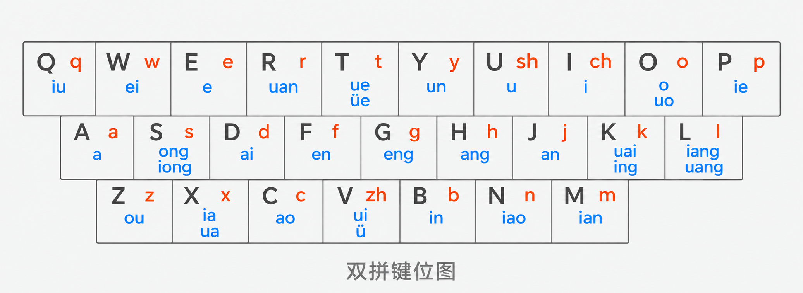

# 双拼

## 为什么使用双拼

双拼是一种可以使用单个声母代替多字母韵母，单个韵母代替多字母声母的输入法，目的是保证每一个由两个字母组成，可以极大的提高输入效率及连打效率。

## 双拼键位

## 打字练习网站
[Typing Practice](https://www.keybr.com/#!practice)
如果打算使用vim的话还是放弃用workman之类的布局吧

## 参考网址

[小鹤双拼·小鹤音形 官方网站](https://flypy.cc/)
